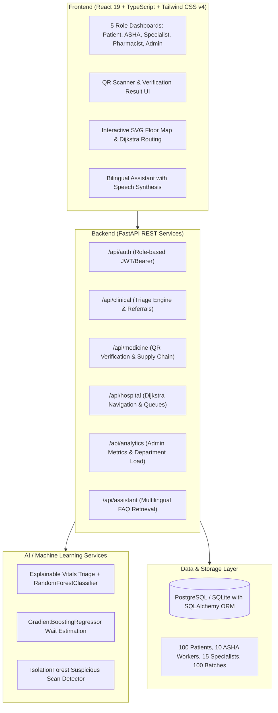

# CareBridge AI — Intelligent Healthcare Access and Assistance Platform

CareBridge AI is an integrated, full-stack healthcare prototype developed for rural and semi-urban populations in India. It directly bridges the gap between Primary Healthcare Centres (PHCs) and district hospitals by solving three systemic challenges:

1. **Lack of specialist doctors at rural PHCs** via explainable AI triage and specialist tele-referral.
2. **Counterfeit and expired medicines** via serialized QR verification, repeat scan anomaly detection, and append-only supply chain trails.
3. **Overcrowding and confusion in public hospitals** via graph-based interactive floor navigation and dynamic queue wait estimation.

---

## 🌟 Key Architecture & Highlights



---

## 🚀 Quick Start Guide

### 1. Prerequisites
- Python 3.11+
- Node.js 18+ and npm

### 2. Backend Setup
```bash
cd backend
python3 -m venv venv
source venv/bin/activate
pip install -r requirements.txt

# Run database migration & populate 100+ synthetic demonstration records
python3 app/database_seed.py

# Train / verify ML models
python3 ml/scripts/train_models.py

# Run unit tests
python3 tests/test_engines.py

# Start FastAPI server (runs on http://localhost:8000)
uvicorn app.main:app --host 0.0.0.0 --port 8000 --reload
```

### 3. Frontend Setup
```bash
cd frontend
npm install

# Start Vite development server (runs on http://localhost:5173)
npm run dev

# Or build production assets
npm run build
```

---

## 👥 Hackathon Evaluation Demo Accounts

All demo accounts use password: `CareBridge@2026`

| Role | Email | Profile Focus |
|---|---|---|
| **Patient** | `patient@carebridge.org` | Sunita Devi: Active cardiac tele-referral, queue token, and journey planner |
| **ASHA Worker** | `asha@carebridge.org` | Pooja Verma: Community vitals collection, AI triage assessment, and specialist referral |
| **Specialist Doctor** | `doctor@carebridge.org` | Dr. Rajesh K. Sharma: Cardiologist review console with observations & action recommendations |
| **Pharmacist** | `pharmacist@carebridge.org` | Anil Gupta: Jan Aushadhi batch registration, QR code generation, and suspicious scan review |
| **Administrator** | `admin@carebridge.org` | Dr. Shalini Mukhopadhyay (CMO): Departmental utilization, average wait times, and audit logs |

---

## 🧪 Interactive Demo Features to Test

1. **AI Clinical Triage Review**:
   - Log in as **ASHA Worker** (`asha@carebridge.org`).
   - Open "New Clinical Case", enter high vitals (e.g. SpO2 89%, BP 180/110) with symptom "chest pain".
   - Observe real-time **Urgent Review** classification, emergency banner, and point-by-point explainable factors.
2. **Medicine Verification**:
   - Navigate to "Verify Medicine".
   - Click "Load Valid Demo QR" to verify authentic Amoxicillin with full supply chain trail.
   - Click "Load Expired Demo QR" to see red expired alerts.
   - Click "Load Suspicious Demo" to see anomaly flags triggered by repeated scans.
3. **Interactive Hospital Floor Navigation**:
   - Open "Hospital Map".
   - Select Source: `Main Entrance Gate A` and Destination: `Cardiology Suite (Floor 2)`.
   - Click "Find Shortest Route" to view the Dijkstra path across floors with turn-by-turn steps and text-to-speech audio guidance.
4. **Bilingual Health Assistant**:
   - Open "Health Assistant", toggle between **EN** and **हिं**.
   - Ask about OPD timings, emergency care, or medicine verification, and click "Read aloud" for browser speech synthesis.

---

## 🔒 Security & Medical Ethics Disclaimer
CareBridge AI is an assistive technology prototype built for clinical decision support and administrative navigation. It does not provide autonomous clinical diagnoses or prescribe medication. In real-world emergency scenarios, patients are instructed to contact national emergency services (108) immediately.
