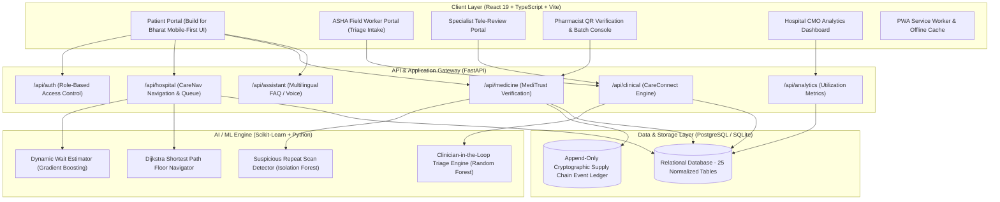

# System Architecture: CareBridge AI

---

## Technical Component Details
1. **Frontend:** React 19 single-page application built with Vite, TypeScript, Tailwind CSS v4, Framer Motion, and HTML5 QR Scanner.
2. **Backend Services:** Asynchronous FastAPI endpoints equipped with Pydantic validation schemas.
3. **Graph Navigation:** Dijkstra's algorithm running on in-memory adjacency graphs of multi-floor hospital nodes.
4. **Machine Learning Pipelines:** Model artifacts serialized with Joblib and documented in `backend/ml/models/`.
