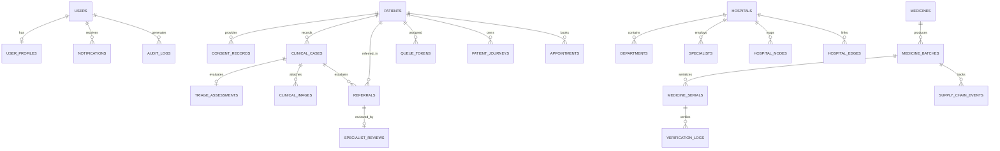

# Database Schema & Entity Relationship: CareBridge AI

CareBridge AI utilizes a normalized PostgreSQL-compatible schema with 25 relational tables and constraints:

---

## Key Table Summaries

* `users`: Authentication credentials, role enums, password hashes.
* `patients`: Unique identifier `patient_id_number` (`PAT-2026-XXXX`), age, village, contact.
* `clinical_cases`: Vital signs ($\text{SpO}_2$, systolic/diastolic BP, pulse, temp), symptoms, duration.
* `triage_assessments`: Priority levels, numerical risk score ($0.0 - 1.0$), explainable factors, missing items.
* `referrals`: Linkage between PHC clinical case, patient, referring worker, and specialist.
* `medicine_batches`: Batch number, manufacturing date, expiry date, regulatory code.
* `medicine_serials`: Serial number, QR payload string, scan frequency, suspicion status.
* `supply_chain_events`: Append-only event blocks with current and previous SHA-256 hashes.
* `hospital_nodes` & `hospital_edges`: Multi-floor coordinates, department tags, distances, and ramp/elevator accessibility flags.
* `queue_tokens`: Department token number, status (`waiting`, `serving`), and predicted wait time.
